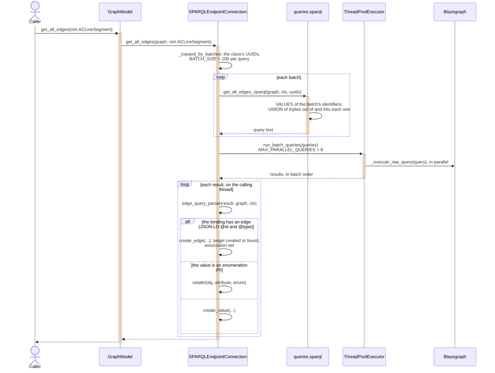
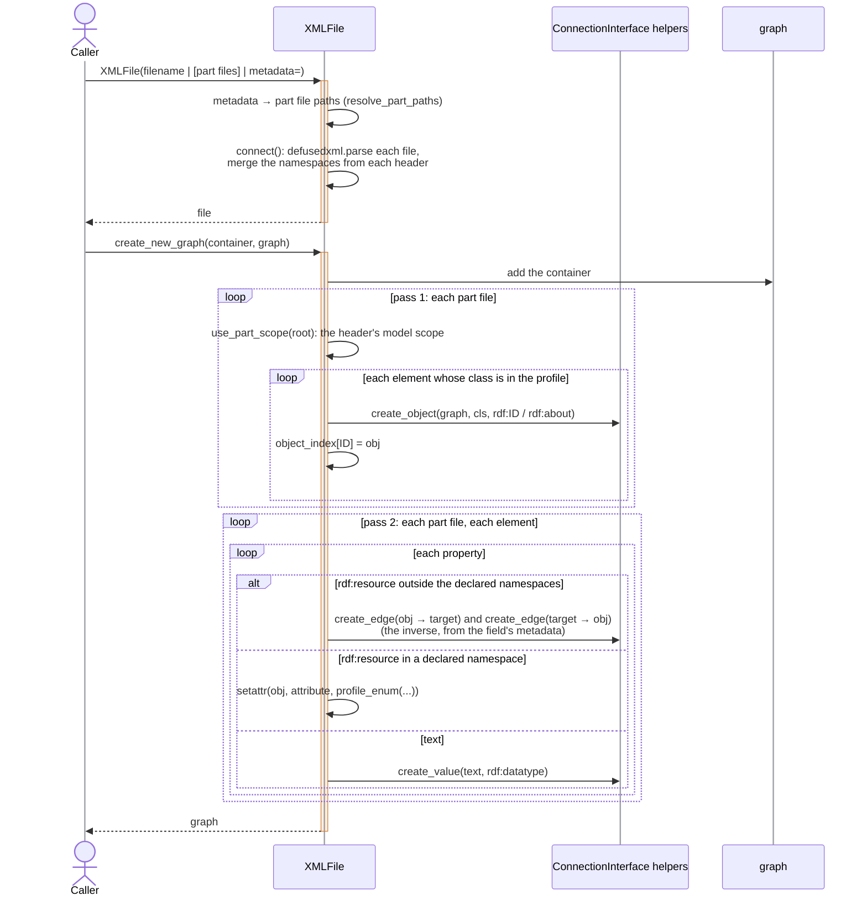

# Connections

A connection turns a source of CIM data (a file, a triple store, a graph database) into dataclass objects in a
model's `graph`. Every connection implements the same interface, so models never know which source they read
from.

## `ConnectionInterface`

`databases/__init__.py` defines the abstract base class:

| Method | Does |
|---|---|
| `connect()`, `disconnect()` | open and close the source |
| `execute(query)` | run query text native to the backend |
| `create_new_graph(container, graph)` | the first layer of a model: the container's equipment, Terminals and nodes (a file: every object) |
| `create_distributed_graph(area, graph)` | the same for one `SubSchedulingArea` |
| `get_all_edges(graph, cls)` | every attribute and association of every `cls` object in the graph; new neighbours are created |
| `get_all_attributes(graph, cls)` | the same, but never adds objects: a reference to an object not in the graph stays an identifier |
| `get_object(mRID, graph)` | one object by mRID or identifier |
| `get_from_triple(subject, predicate, graph)` | the objects one association of one object points at |
| `upload(graph)` | write the graph back to the source |

The base class also holds the shared helpers that every backend uses to change the graph. They are the reason a
new backend is mostly query text and result parsing:

| Helper | Does |
|---|---|
| `create_object(graph, cls, uri)` | the object with this identifier from the graph, else a new `cls(identifier=uri)` added to it |
| `create_value(graph, cls, identifier, attribute, text, datatype)` | sets an attribute from text: bool, int, float, or the field's `CIMUnit` |
| `create_edge(graph, cls, identifier, attribute, edge_cls, edge_id)` | creates (or finds) the target and sets the association, appending to a list side |
| `create_reference(...)` | like `create_edge`, but sets the identifier text if the target isn't in the graph |
| `check_attribute(cls, name)` | resolves a source attribute name to the dataclass field, cached per instance |
| `set_undefined_attribute(...)` | what happens to a name the profile doesn't have (`CIMG_ALLOW_UNDEFINED_ATTRIBUTES`) |
| `profile_enum`, `enum_from_iri` | an enumeration value from its class and name, or from its IRI |

## The SPARQL endpoints

`SPARQLEndpointConnection` (`databases/sparql_endpoint.py`) implements the whole interface on top of four hooks.
`BlazegraphConnection` and `GraphDBConnection` implement only those four:

| Hook | Blazegraph |
|---|---|
| `_setup_connection()` | a `SPARQLWrapper` on `CIMG_URL`, JSON results |
| `_execute_raw_query(query)` | a new `SPARQLWrapper` per call (it holds the query), so batches can run in parallel |
| `_parse_result_field(result, name)` | `result[name]['value']`, or None |
| `_update_raw(update)` | a SPARQL update over POST |

### `get_all_edges`, end to end

- **Only this end is set.** The parser sets the association on the object that was queried. The query's UNION
  returns the triples pointing in as well as out, which is how the inverse side gets filled.
- **The identifier form follows `CIMG_IEC61970_552`.** With `552-NEW`, the query makes each identifier an IRI
  under `urn:uuid:`; otherwise under `CIMG_URL#`. It reads the getters when it builds the query.
- **Text is checked before it goes into a query.** Identifiers, attribute names and IRIs pass through
  `core/validation.py`'s guards, so text from a file can't inject SPARQL or Cypher.

The other query-backed connections follow the same pattern with their own query builders and parsers:

| Connection | Differs in |
|---|---|
| `RDFlibConnection` | loads a local RDF/XML file into rdflib (or Oxigraph) and queries it with `queries/rdflib`, serially |
| `Neo4jConnection` | Cypher (`queries/cypher`) on the async driver, batches gated by a semaphore of 8; `upload` imports RDF/XML through neosemantics |
| `MySQLConnection` | SQL on CIMTool's relational schema, read from `information_schema`; read-only (`upload` raises) |
| `GridappsdConnection` | the SPARQL builders sent through GridAPPS-D's query API, serially; units off |

## The file parsers

`XMLFile` and `JSONLDFile` (`databases/fileparsers/`) read the whole file in `create_new_graph`, in two passes,
so that a reference can point at an object anywhere in any part file:

- **Both ends are set here.** A file states an association once, so the parser sets the inverse itself, from
  the field's `inverse` metadata.
- **`object_index` keeps the identifiers.** Pass 1 records the object each ID was read as, under its own part's
  model scope. Pass 2 looks targets up there, so a non-UUID ID resolves to the UUID it was seeded with, even
  after the scope has moved on to another part.
- **Classes outside the profile are skipped**, at the validation log level, and so are references to them.
- **The read-side methods are no-ops.** `get_all_edges` and `get_all_attributes` have nothing to fetch, and
  `create_distributed_graph` raises: a file has no query that selects one area.

`JSONLDFile` does the same with JSON-LD nodes: `parse_node` in the first pass, `parse_edges` in the second,
with units read from the vocabularies in the file's `@context`.

## Adding a backend

1. **Subclass the closest base.** A SPARQL store needs only the four hooks on `SPARQLEndpointConnection`. Any
   other source subclasses `ConnectionInterface` and implements its abstract methods, building objects with the
   shared helpers, never by assigning to `graph` directly.
2. **Put query text in `queries/<language>/`**, as functions of `(graph, cls, identifiers)` that return a
   string. Pass identifiers and names through `core/validation.py`.
3. **Keep parsing on the calling thread.** If you run queries in parallel, only `_execute_raw_query` may run in
   the pool.
4. **Make its driver an optional extra.** Add it to `[project.optional-dependencies]` in `pyproject.toml` and to
   `_OPTIONAL_CONNECTIONS` in `databases/__init__.py`. Users then get an import error that names the extra to
   install, not a bare `ModuleNotFoundError`.
5. **Test it against `XMLFile`.** `tests/test_backends_match_xml.py` loads `ieee13.xml` through each backend in
   its `BACKENDS` list and compares the objects with `XMLFile`'s. Add the backend there, its port to `SERVICES`
   in `tests/conftest.py`, the service to `docker-compose.yml`, and its seeding to `tests/seed_databases.py`.
