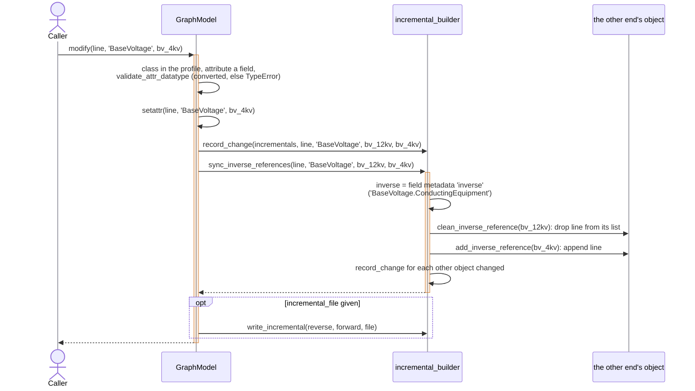
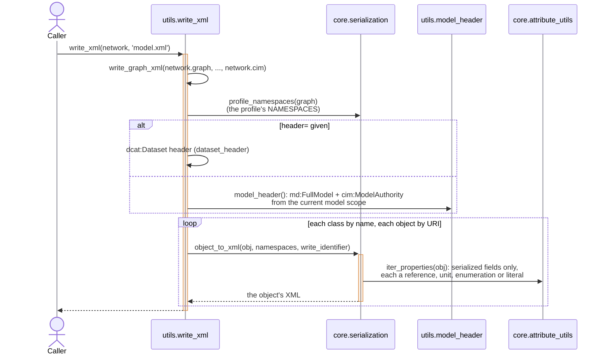

# Editing and writing

A loaded model is changed through three `GraphModel` methods, which keep both ends of every association in step
and record each change as a difference. The writers turn a graph back into CIM RDF/XML or JSON-LD.

## `create`, `modify`, `delete`

| Method | Checks | Then |
|---|---|---|
| `create(cls, **attributes)` | class in the profile, every attribute a field | `cls(**attributes)`, `add_to_graph`, record it as created, sync the inverse of each association given |
| `modify(obj, attribute, value)` | as above; the value validated and converted to the field's datatype, None only on an optional field | `setattr`, record the change, sync the inverse |
| `delete(obj)` | the object is the one in the graph | record it as deleted, remove it from the other end of every association, `del graph[cls][identifier]` |

- **A single-valued inverse moves.** Pointing `terminal.ConnectivityNode` at a new node removes the terminal
  from the old node's `Terminals` as well as adding it to the new one's. Every object touched is recorded.
- **Lists are replaced, never changed in place.** That way a loop over the old list
  (`for point in location.PositionPoints: network.delete(point)`) still sees every item.
- **Ends the profile doesn't have are skipped.** A CIMTool profile may keep only one end of an association;
  the other end is then left alone.

## Differences

`network.incrementals` holds two dicts, `forwardDifferences` and `reverseDifferences`, each
`{cls: {uri: {attribute: value}}}`. For every attribute that has changed, the forward dict holds its value now
and the reverse dict holds its value before the first change. Creating an object changes its `RDF_TYPE` from
None to its class name, and deleting it changes it back.

`record_difference` keeps these minimal. An attribute changed back to its original value has no difference,
and an object created and then deleted has none either. That is why the difference is computed from the first
value and the latest one, not stored as a log of every edit.

| Function | Does |
|---|---|
| `network.write_all_incrementals(file)` | `write_incremental`: a `dm:DifferenceModel` in RDF/XML, with forward and reverse differences |
| `network.from_incremental(file)` | `read_incremental_xml`, then `apply_incremental` |
| `apply_incremental(model, message)` | checks every difference first (unknown class, object, attribute, or a value that doesn't fit, raises before anything changes), then calls `create`, `modify` and `delete`, in that order |
| `incremental_json.write_incremental_gridappsd` | the differences as a GridAPPS-D `update` message (attribute changes only) |
| `incremental_json.read_incremental_gridappsd` | a GridAPPS-D difference message in the form `apply_incremental` takes |

Because `apply_incremental` works through the same three methods, applying a difference file leaves the
graph, its inverse ends and `network.incrementals` exactly as if the edits had been made by hand. A reverse value
that doesn't match the model's current value means the difference was made against another version of the
model. That is a warning, not an error.

## Writing files

- **The output is stable.** Classes are written by name and objects by URI, so writing the same graph twice
  gives the same objects in the same order. Only the header's `md:FullModel` UUID and creation time differ, and a
  `header=` with fixed values gives byte-identical files.
- **What gets written is decided by the profile.** `iter_properties` follows each field's `serialize` metadata.
  A reverse end the profile marks as not serialized is skipped, so each association is written once.
- **Identifiers follow `CIMG_IEC61970_552`.** `rdf:about="urn:uuid:..."` with `552-NEW`, `rdf:ID="_..."` for the
  legacy and CGMES styles. The format is chosen in `core/serialization.py` and is the same for every writer.
- **`write_json_ld`** walks the graph the same way. It builds the profile's `@context` and unit vocabularies
  (`dataset_header.profile_context_and_units`), writes a `dcat:Dataset` node, and then calls
  `object_to_json_ld` on each object.
- **`upload()` picks the writer.** On a model read from an `XMLFile`, `network.upload()` writes the graph back to
  that file with `write_xml`. On any other connection it calls `connection.upload(graph)`.
