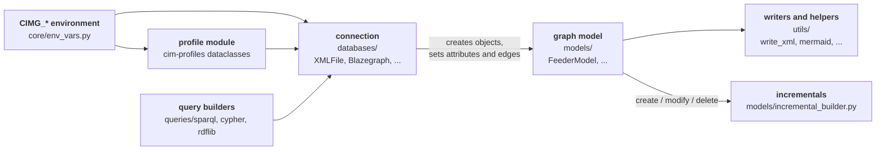

# Developer docs

These pages are for people changing `cim-graph` itself: how a model gets built, what each layer owns, and the
rules that keep it correct. The [User guide](../guide/index.md) covers using the package.



| Page | Covers |
|---|---|
| [Profiles and identity](profiles.md) | how the profile module is chosen, merged profiles, the environment getters, identifiers, seeded UUIDs and model scope |
| [Building a model](models.md) | `GraphModel`'s graph, `add_to_graph` and the mRID index, each model class's start-up, centralized and distributed |
| [Connections](connections.md) | `ConnectionInterface`, the SPARQL endpoint template, `get_all_edges` down to the query, the two-pass file parsers, adding a backend |
| [Editing and writing](editing.md) | `create`/`modify`/`delete`, inverse sync, difference models, `write_xml` and `write_json_ld` |
| [Package structure](../01_overview/1_3_structure.ipynb) | the layer diagram and the package layout |
| [Building profiles](../02_cim_profiles/2_2_building_profiles.ipynb) | generating a custom profile with CIMTool |
| [Contributing](../01_overview/1_4_contributing.ipynb) | branches, pull requests and coding standards |

## The modules

| Module | Owns |
|---|---|
| `core/env_vars.py` | every `CIMG_*` getter, `get_cim_profile`, `set_model_scope` |
| `core/attribute_utils.py` | field metadata: serialized attributes, `field_properties`, datatype validation and conversion |
| `core/serialization.py` | one object as RDF/XML, JSON-LD or SPARQL triples, and identifier text per IEC 61970-552 style |
| `core/validation.py` | regex guards on identifiers, attribute names and IRIs before they go into a query |
| `models/graph_model.py` | `GraphModel`: the graph, the mRID index, search, `create`/`modify`/`delete`, `upload` |
| `models/feeder_model.py`, `node_breaker_model.py`, `bus_branch_model.py`, `distributed_area.py` | each model's start-up from its container |
| `models/incremental_builder.py` | recording differences, inverse sync, reading and writing difference models |
| `models/incremental_json.py` | GridAPPS-D difference messages |
| `databases/__init__.py` | `ConnectionInterface` and the shared object, value and edge creators; lazy loading of optional backends |
| `databases/sparql_endpoint.py` | `SPARQLEndpointConnection`: everything shared by Blazegraph and GraphDB |
| `databases/<backend>/` | one connection per database: `blazegraph`, `graphdb`, `neo4j`, `mysql`, `rdflib`, `gridappsd` |
| `databases/fileparsers/` | `XMLFile`, `JSONLDFile`, and the IEC 61970-552 metadata and model headers |
| `queries/sparql`, `cypher`, `rdflib` | functions that build query text; they never run anything |
| `utils/` | writers (`write_xml`, `write_json_ld`, headers), `get_all_data`, `mermaid` |

## Rules that keep it correct

- **Configuration is process-global.** The profile, namespace, identifier style and model scope are environment
  variables read through `@cache`d getters. Every connection's `__init__` clears those caches and reads them
  again, so a connection sees the environment as it was when it was created. Query builders read the getters
  when they build a query, not from the connection.
- **The graph is keyed by identifier.** `graph[cls][identifier]` is the only place an object lives. Never change
  an object's `identifier` or `mRID` after it is in the graph: the mRID index is rebuilt only when the object
  count changes, so an in-place rename leaves it stale.
- **One object per identifier.** `create_graph_object` returns the object already in the graph for an ID, so two
  queries that reach the same object share it. Adding a *different* instance with the same identifier raises.
- **Only `create`, `modify` and `delete` record differences.** Readers and queries set attributes directly; they
  are loading a model, not changing it. Code that edits a loaded model must go through the three methods so the
  inverse side and `network.incrementals` stay in step.
- **The graph is changed on one thread.** `SPARQLEndpointConnection` runs batch queries in parallel, but parses
  every result on the calling thread. A backend's `_execute_raw_query` must be thread-safe; its parser must not
  run in the pool.
- **The profile is the schema.** No module keeps a list of CIM classes. Class and attribute names are looked up
  on the profile module (`cim.__all__`, dataclass fields and their `metadata`), so a new profile needs no code
  change.

## Working on it

```bash
uv sync --all-extras                 # the package, every database driver, and the dev group
uv run pytest -m "not integration"   # what CI runs on every push
```

Tests that need a database are marked `@pytest.mark.integration('<service>')` and skip when nothing listens on
that service's port (`tests/conftest.py`). To run them, start the databases and load the test models first:

```bash
docker compose up -d --wait
uv run python tests/seed_databases.py
uv run pytest -m integration
```

## Building the docs

The site is MkDocs Material with `mkdocs-jupyter`, built from `docs/` and `mkdocs.yml`:

```bash
pip install -r docs/requirements-mkdocs.txt   # Python 3.12+ (mkdocs-jupyter)
mkdocs serve                                  # http://127.0.0.1:8000, rebuilt on save
mkdocs build --strict                         # what CI runs; a broken link or anchor fails it
```

Notebooks are rendered with the outputs saved in them; the build never executes them. After changing a notebook,
re-run it from its own directory (its paths are relative to it) and commit it with its outputs. The database
notebooks need that database running. `.github/workflows/docs.yml` builds every pull request that touches the
docs and deploys `develop` to GitHub Pages.

The theme (`docs/stylesheets/extra.css`, and the `theme` block of `mkdocs.yml`) is shared with the
[CIM-Tables](https://pnnl-cim-tools.github.io/CIM-Tables/) site. Change both together.
