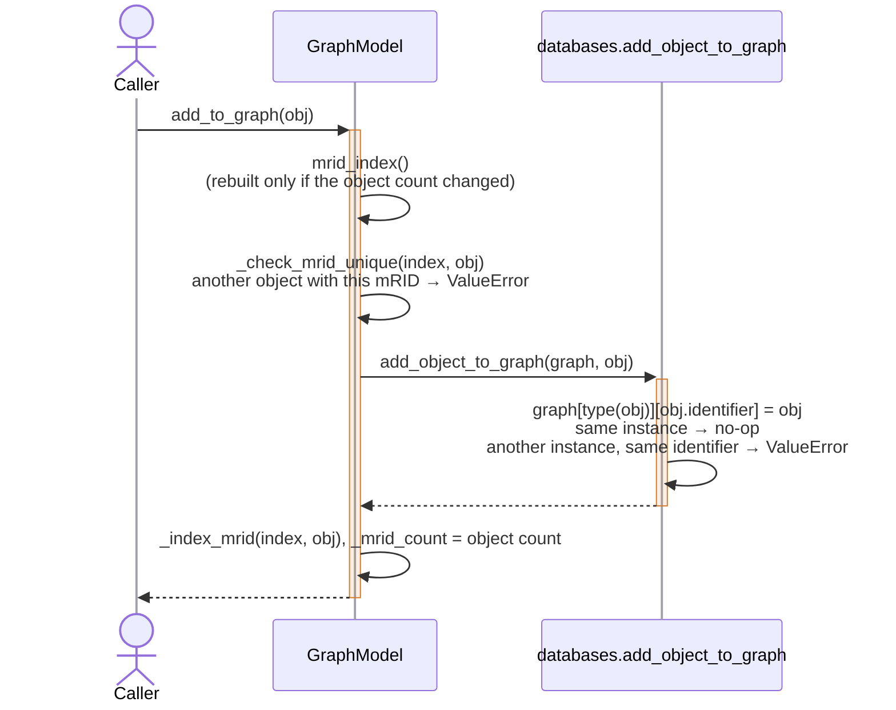
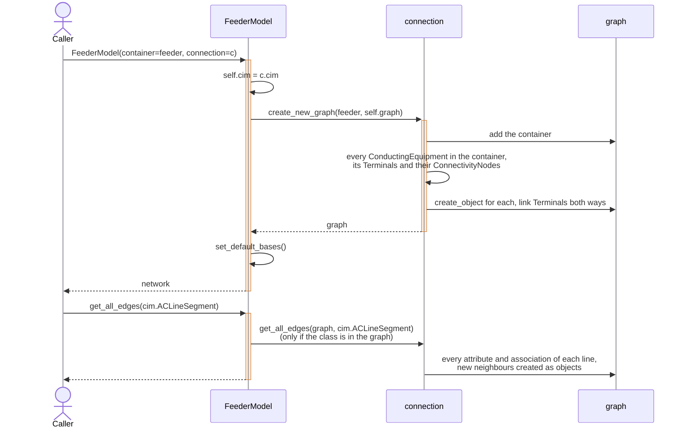
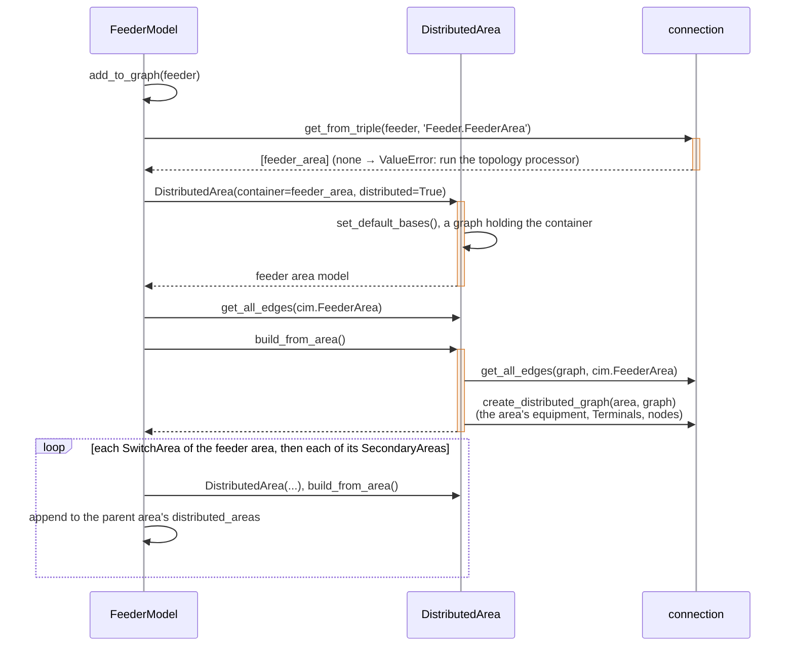

# Building a model

A graph model is a container object plus every CIM object reachable from it, held in one dict. The model classes
differ only in how they start: which connection call fills the first layer of the graph, and whether they split
it into areas. After that, every model grows the same way, one `get_all_edges` call per class.

## The graph

`GraphModel` (`models/graph_model.py`) is a dataclass:

| Field | Is |
|---|---|
| `container` | the CIM object the model is built from (a `Feeder`, `Substation`, `GeographicalRegion`, ...), or None |
| `connection` | a `ConnectionInterface`, or None for a model built in memory |
| `distributed` | split the model into `DistributedArea`s (`FeederModel` only) |
| `graph` | `dict[type, dict[UUID, object]]`: CIM class → identifier → object |
| `cim` | the profile module, set by the subclass (see [Profiles and identity](profiles.md)) |
| `incrementals` | every `create`, `modify` and `delete` since loading (see [Editing and writing](editing.md)) |
| `base_power`, `base_frequency` | the system bases, from `set_default_bases` |

`graph` is keyed by exact class: `graph[cim.Breaker]` holds breakers, and no subclasses. `FeederModel` and
`BusBranchModel` replace an empty graph with a `defaultdict`, so `network.graph[cim.X]` is `{}` for a class the
model doesn't have.

### Adding an object

`find_by_mRID(mRID)` reads that index and never queries the connection; `get_object` is the call that asks the
connection. Readers and queries put objects into `graph` directly, without `add_to_graph`. The index picks them
up the next time it is read, because the object count has changed.

### System bases

Every model class calls `set_default_bases()` last in `__post_init__`, after the graph is loaded. The
`base_power` comes from the graph's `BasePower.basePower`, else `CIMG_SYSTEM_MVA_BASE` (default 100 MVA). The
`base_frequency` comes from `BaseFrequency.frequency`, else 60 Hz. If two objects disagree with each other, or
one disagrees with a base passed in explicitly, it raises: a model has one system base of each.

## Model start-up

Every subclass follows the same steps in `__post_init__`: take `cim` from the connection, load the first layer
of the graph from the container, then call `set_default_bases()`. With no connection, it only sets `cim`, and you
build the model with `add_to_graph`.

What `create_new_graph` returns depends on the connection:

- **A query-backed connection** (the SPARQL endpoints, RDFLib, Neo4j, MySQL) returns the first layer only: the
  container's equipment, their Terminals and the ConnectivityNodes. The equipment's own attributes, and
  everything beyond it, come from `get_all_edges` calls.
- **A file** (`XMLFile`, `JSONLDFile`) is read whole: `create_new_graph` reads every object in the file, whether
  or not it is in the container, and `get_all_edges` has nothing left to do.

| Class | `create_new_graph(container)`, then | `distributed=True` |
|---|---|---|
| `FeederModel` | nothing more | splits into areas (below) |
| `NodeBreakerModel` | `add_to_graph(container)` if there is one | `NotImplementedError` |
| `BusBranchModel` | nothing more | `NotImplementedError` |
| `DistributedArea` | (built by `FeederModel`, below) | always |

## Distributed feeders

With `distributed=True`, `FeederModel` builds a tree of `DistributedArea` models, one per area of the CIM
hierarchy `Feeder` → `FeederArea` → `SwitchArea` → `SecondaryArea`. Each area has its own `graph`, holding only
that area's objects. Built from a database:

- **Areas must already exist.** The `FeederArea` / `SwitchArea` / `SecondaryArea` objects come from the CIM
  Graph Topology Processor; without them the feeder raises.
- **A topology message works too.** Given GridAPPS-D's topology message instead of a database hierarchy,
  `FeederModel` builds the same tree from the message (`DistributedArea.build_from_topo_message`).
