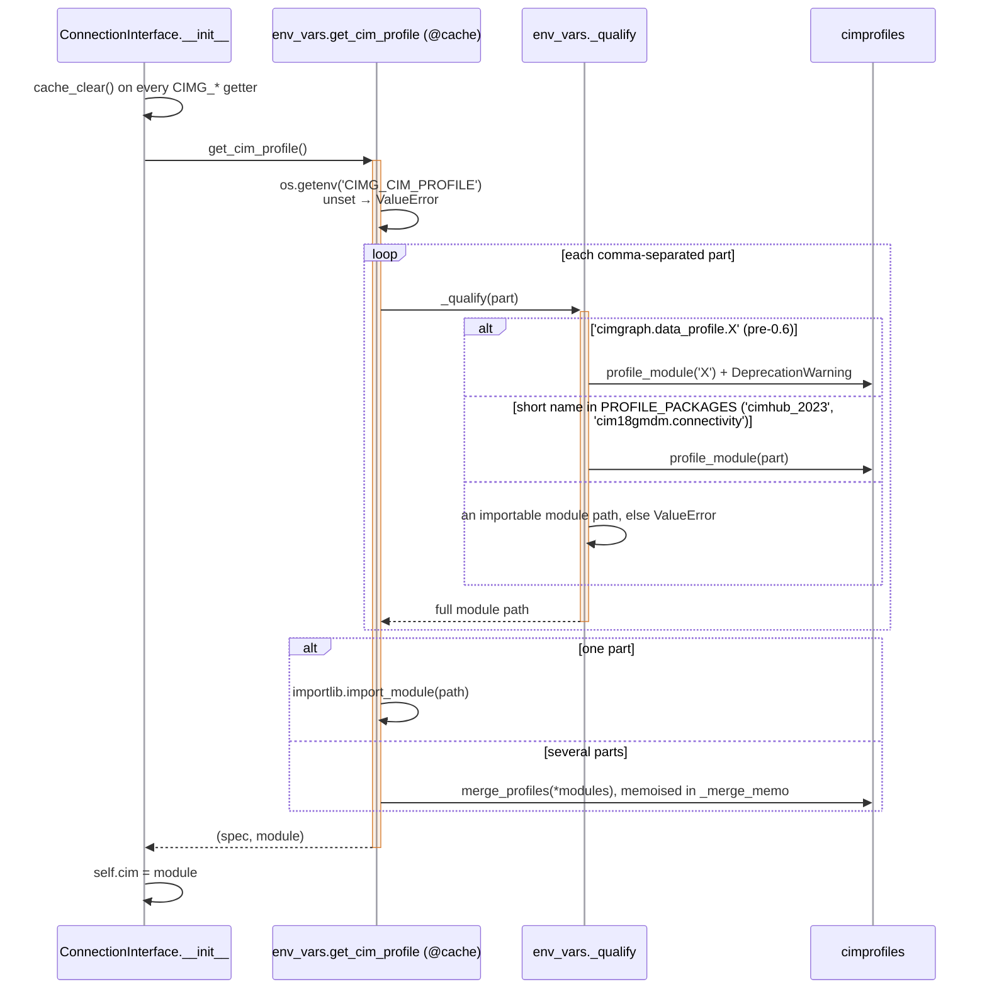
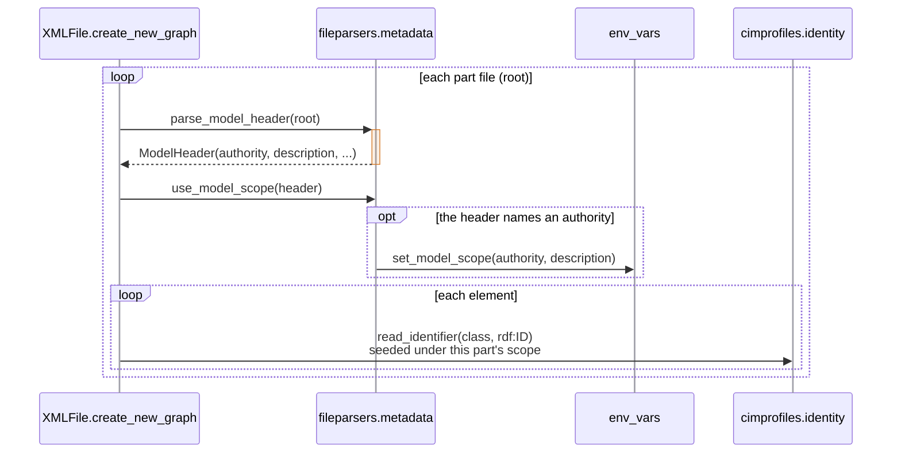

# Profiles and identity

Two pieces of process-wide state decide what every model looks like: the **profile**, which is the module of
CIM dataclasses that objects are made from, and the **model scope**, which is the authority and model name that
seed UUIDs. Both live in environment variables and are read through the getters in `cimgraph/core/env_vars.py`.

## Choosing the profile module



- **Every spelling gives the same module.** A short name, a full path and a legacy `data_profile` path all
  resolve to one module path, which is also the merge memo key. Two spellings of one merged profile would
  otherwise build two sets of merged classes, whose objects would miss each other's graph keys.
- **Merged profiles outlive `cache_clear()`.** `_merge_memo` is a module dict, not the `@cache`, so a new
  connection gets the same merged module (and the same classes) as the last one.
- **Models take the connection's module.** `FeederModel`, `NodeBreakerModel` and `BusBranchModel` set
  `self.cim = connection.cim`, or call `get_cim_profile()` themselves when there is no connection (a model built
  in memory). `GraphModel` itself sets nothing.

### The environment getters

Each `CIMG_*` variable has one getter, and nothing else reads `os.environ`. The defaults and allowed values are
in the [Environment variables](../03_databases/3_2_env_variables.ipynb) page. A connection copies the ones it
needs onto itself at `__init__` (`cim`, `namespace`, `iec61970_552`, `log_level`, `use_units`,
`allow_undefined`). The query builders in `queries/` call the getters when they build each query, so a query
reflects the environment of the moment.

## Identifiers and seeded UUIDs

In CIM 18, an object's `identifier` is a UUID and its `mRID` is a free-form string unique within the model.
`Identity.__post_init__` (in `cimprofiles.identity`) decides the UUID:

| The object is made with | Its `identifier` |
|---|---|
| `identifier=` text that holds a UUID, in any serialization (`_uuid`, `#_uuid`, `urn:uuid:...`) | that UUID |
| `identifier=` or `mRID=` text that is not a UUID | `seeded_uuid(class, mRID)`, the text kept as `mRID` |
| only a `name` | `seeded_uuid(class, name=name)`, so a rename makes a new object |
| nothing | a random `uuid4` |

```text
seeded_uuid = uuid5(model_authority_namespace(CIMG_MODEL_AUTHORITY),
                    CIMG_MODEL_NAME + '+' + class + '+' + mRID + '+' + name + '+' + seed)
```

The class is part of the seed, so the same mRID in two classes gives two UUIDs. Readers use the same rule
through `read_identifier(class_name, uri)`, which is how a reference to an object can be resolved to its graph
key before the object itself is read.

## Model scope

`set_model_scope(authority, model_name)` writes `CIMG_MODEL_AUTHORITY` and `CIMG_MODEL_NAME` and clears their
getters. From then on, seeded UUIDs use that scope, and so does the header of the next export.



- **Readers set it per part file.** `XMLFile` and `JSONLDFile` apply each part's header before reading that
  part's objects, so a non-UUID ID is seeded under the authority that issued it. A header without an authority
  leaves the scope as it was.
- **Writers read it back.** `utils.model_header.model_header()` writes the current scope into `md:FullModel` /
  `cim:ModelAuthority`, with the authority's UUID namespace. That is what lets a reader of the exported file seed
  the same UUIDs again.
- **It is global.** Reading a file changes the scope for everything that runs after it in the process,
  including the UUIDs of objects you build afterwards. The autouse `restore_model_scope` fixture in
  `tests/conftest.py` puts it back after every test, so tests don't depend on their order.
