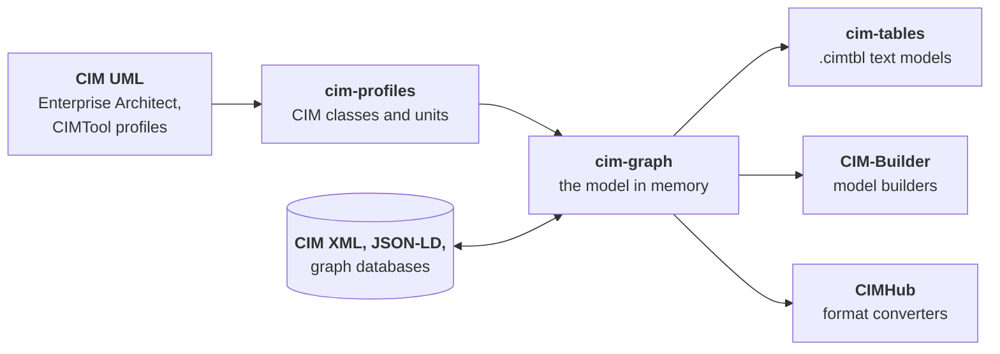

<div class="ct-hero" markdown>

# CIM power-system models as <span class="ct-accent">Python objects</span>

<p class="ct-lede"><code>cim-graph</code> reads IEC CIM models from CIM XML, JSON-LD or a graph database into an
in-memory knowledge graph of typed CIM objects. You navigate it by following associations, edit it, and write it
back out. The same API works for distribution feeders, node-breaker and bus-branch transmission models, and
distributed areas.</p>

[Quick start](01_overview/1_1_overview.ipynb){ .md-button .md-button--primary }
[Install](01_overview/1_2_installation.ipynb){ .md-button }
[Developer docs](developer/index.md){ .md-button }

</div>

```python
import os
os.environ['CIMG_CIM_PROFILE'] = 'cimhub_2023'

import cimprofiles.cim17.cimhub_2023 as cim
from cimgraph.databases import XMLFile
from cimgraph.models import FeederModel
from cimgraph.utils import write_json_ld

feeder = cim.Feeder(mRID='49AD8E07-3BF9-A4E2-CB8F-C3722F837B62')  # IEEE 13-bus
network = FeederModel(connection=XMLFile('ieee13.xml'), container=feeder)

network.get_all_edges(cim.ACLineSegment)  # every line's attributes and neighbours
for line in network.graph[cim.ACLineSegment].values():
    print(line.name, f"{line.length.to('ft'):.0f} ft")

write_json_ld(network, 'ieee13.jsonld')
```

```text
650632 2000 ft
632670 667 ft
670671 1333 ft
...
```

To read the model from Blazegraph instead of a file, swap `XMLFile(...)` for `BlazegraphConnection()`; nothing
else in the code changes. With a database, `get_all_edges` is the call that fetches the lines. A file is read
whole, so there it has nothing left to fetch.

<div class="grid cards" markdown>

-   :material-file-tree-outline:{ .lg .middle } __The profile is the schema__

    ---

    Every CIM class is a Python dataclass generated from the UML: typed attributes, associations with their
    inverses, and enumerations. Pick a profile with one environment variable, or merge several.

    [:octicons-arrow-right-24: CIM profiles](02_cim_profiles/2_1_profiles_overview.ipynb)

-   :material-database-sync-outline:{ .lg .middle } __One API, many sources__

    ---

    CIM XML, JSON-LD, RDFLib, Blazegraph, GraphDB, Neo4j, MySQL and GridAPPS-D all sit behind the same
    connection interface.

    [:octicons-arrow-right-24: Choosing a connection](03_databases/3_1_databases_overview.ipynb)

-   :material-transmission-tower:{ .lg .middle } __Feeders, substations, buses__

    ---

    `FeederModel`, `NodeBreakerModel` and `BusBranchModel` start from a container and expand the graph one
    association at a time. Use them centralized, or split into distributed areas.

    [:octicons-arrow-right-24: Graph models](04_graph_models/4_1_graph_models.ipynb)

-   :material-ruler:{ .lg .middle } __Units, not bare numbers__

    ---

    Physical quantities are `CIMUnit`s stored in SI: `cim.Length(1.2, 'km')` in, `.to('ft')` out. There is no
    hand-written `1e3` anywhere.

    [:octicons-arrow-right-24: Units](02_cim_profiles/2_5_using_units.ipynb)

-   :material-file-compare:{ .lg .middle } __Edits you can send__

    ---

    `create`, `modify` and `delete` keep both ends of each association in step and record every change, which
    you can write out as a CIM difference model.

    [:octicons-arrow-right-24: Editing a model](02_cim_profiles/2_4_using_incrementals.ipynb)

-   :material-identifier:{ .lg .middle } __Stable identities__

    ---

    An ID that isn't a UUID gets one seeded from the model's authority and name and the object's mRID, so the
    same source always gives the same UUIDs. The IEC 61970-552 identifier styles are supported, both new and legacy.

    [:octicons-arrow-right-24: Objects and identity](02_cim_profiles/2_3_using_objects.ipynb)

</div>

## Where it fits



`cim-graph` is the hub of the PNNL CIM tools. [CIM-Tables](https://pnnl-cim-tools.github.io/CIM-Tables/) writes
models as plain-text tables, CIM-Builder builds them in code, and CIMHub converts them to and from other formats
such as OpenDSS.
